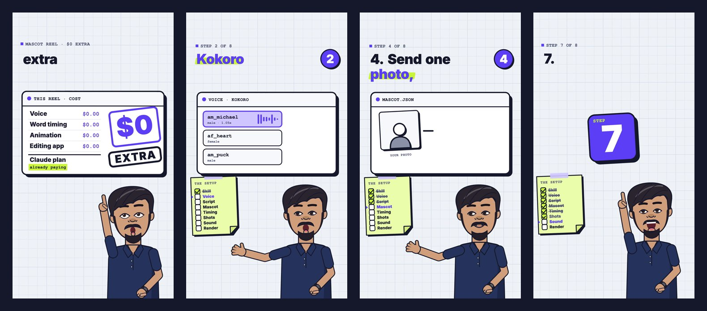

<div align="center">

# Mascot Explainer Reels

**Turn yourself into a cartoon host and make how-to reels with Claude.**

All in code, on your own computer. $0 extra: no API keys, no AI images, no credits.

[Install](#install) · [How it works](#how-it-works) · [Guide (PDF)](https://nestedbit.com/skills/mascot-reels) · [NestedBit](https://nestedbit.com)



</div>

## What you get

A 30-60 s vertical reel (Instagram, YouTube Shorts, TikTok) where **you, as a cartoon mascot**, present "N quick steps".

- 🧑‍🎨 **Your mascot** drawn in code from one photo, rigged and lip-synced
- 🗣️ **Free local voice** (Kokoro) or your own recording
- 💬 **Word-by-word captions**, timed to the voice with Whisper
- 🃏 **Step cards**, number tiles, a live checklist, camera shake
- 🔊 **Sound on every hit** plus a music bed, mixed for phones
- 🎬 **MP4 render** that Claude checks frame by frame before you see it

## Install

```bash
git clone https://github.com/nestedbit/faceless-shorts ~/.claude/skills/faceless-shorts
```

No git? **Code → Download ZIP**, unzip to `~/.claude/skills/faceless-shorts/`.

Then in Claude Code:

1. *"Run the faceless-shorts setup and selftest."* Wait for **All set** and **SELFTEST PASSED**.
2. Start a new session, send one front-facing photo and ask:
   > Make me a Mascot Explainer reel: 4 quick steps to spot a phishing email.

## How it works

```
script  →  voice (Kokoro)  →  word timings (Whisper)  →  mascot + shots on canvas
        →  sound + music   →  headless Chrome frames  →  ffmpeg MP4
```

Everything after the script runs locally. Kokoro and Whisper are the only AI models, and both are free.

## Requirements

| Need | Notes |
|---|---|
| Claude | A paid plan with Claude Code |
| Node.js 22+, ffmpeg, Chrome, Python 3.10+ | Claude installs what's missing |
| ~1 GB disk | Voice and Whisper models |
| Windows | Run scripts in Git Bash |

## What's inside

```
SKILL.md                      what Claude follows
scripts/                      setup, selftest, new_video, voice, words, estimate
styles/mascot-explainer/
  style-sheet.png             the look in one image
  STYLE.md                    rules + engine manual
  example/                    a full project that renders as-is
```

Optional: ask Claude to upload the finished reel to YouTube through Zapier. It confirms title and visibility first.

## License

Code, drawings and sound: [MIT](LICENSE), free to use in your videos.
Fonts keep their own licenses ([LICENSES/](LICENSES)): Inter (OFL 1.1), FreeMono (GPL-3.0 with font exception, so your video stays yours).
Downloaded on setup: Kokoro-82M (Apache-2.0), kokoro-onnx, faster-whisper, Whisper small.en (MIT).

---

<div align="center">

Made by [NestedBit](https://nestedbit.com) · [@nestedbit.ai](https://www.instagram.com/nestedbit.ai/)

</div>
