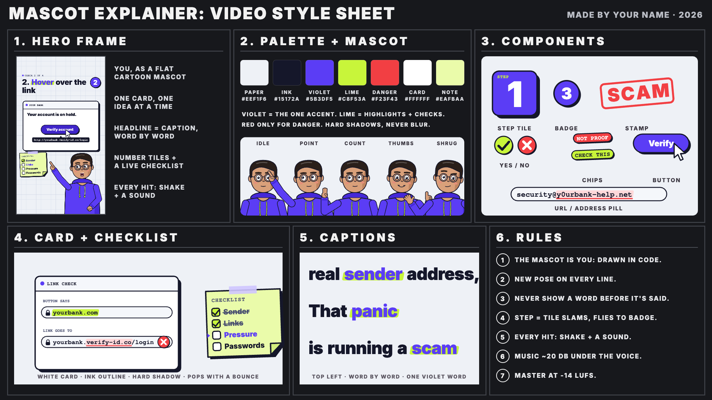

# Mascot Explainer reels with Claude: a free Claude skill

By [NestedBit](https://nestedbit.com) · [@nestedbit.ai](https://www.instagram.com/nestedbit.ai/) on Instagram

You, as a flat cartoon mascot drawn in code from one photo, presenting "N quick steps" in a vertical reel (Instagram
Reels, YouTube Shorts, TikTok). Claude writes the script, draws and rigs your mascot, lip-syncs it to the voice, times
every word, animates the cards, adds sound and music, and renders the MP4, all in code on your own computer.
No AI images or video, no API keys, no extra credits: the only cost is the Claude plan you already have.



**What a reel looks like:** one card at a time, number tiles that slam into a corner badge, a live checklist, big
word-by-word headline captions, camera shake and a sound on every hit, your mascot bottom right. 30-60 s, 9:16.
Example project included: *How to spot a fake email*.

**How it works**
script.json → Kokoro voice (local, free) → Whisper word timings (local, free) → your mascot (`mascot.json`) and every
shot drawn on canvas, each cut and caption placed on its word → procedural sound + music → headless Chrome captures every
frame → ffmpeg renders the MP4. Claude checks a contact sheet of the whole reel before you ever see it.
Optional: when you ask, Claude uploads the finished short to your YouTube channel through Zapier (it confirms title,
visibility and category first).

**Needs:** a paid Claude plan with Claude Code (or Claude with a linked computer), Node.js 22+, ffmpeg, Google Chrome,
Python 3.10+, ~1 GB for the voice and Whisper models. Claude installs what's missing.

**Windows:** run the scripts in Git Bash (installed with Git for Windows; Claude Code uses it already).

**Install:**

```bash
git clone https://github.com/nestedbit/faceless-shorts ~/.claude/skills/faceless-shorts
```

No git? Click **Code → Download ZIP** above and unzip it to `~/.claude/skills/faceless-shorts/`.
Then ask Claude Code to run `bash scripts/setup.sh` (prints "All set") and `bash scripts/selftest.sh`
(prints "SELFTEST PASSED"). Start a new session, send one clear front-facing photo, and ask:
"Make me a Mascot Explainer reel: 4 quick steps to spot a phishing email."

**Layout:** `SKILL.md` (what Claude follows) · `scripts/` (setup, selftest, new_video, voice, words, estimate) ·
`styles/mascot-explainer/` (`style-sheet.png`, `STYLE.md`, `example/` = a complete project that renders as-is).

**Licenses:** the code, stories, drawings and sound are original, MIT licensed ([LICENSE](LICENSE)) and free to use in your videos.
Bundled fonts keep their own licenses ([LICENSES/](LICENSES)): Inter, SIL Open Font License 1.1; FreeMono (GNU FreeFont),
GPL-3.0 with the font exception, so using it in a video doesn't make the video GPL. Installed on first use: Kokoro-82M
(Apache-2.0) via kokoro-onnx (MIT), faster-whisper + Whisper small.en (MIT), numpy, scipy.
